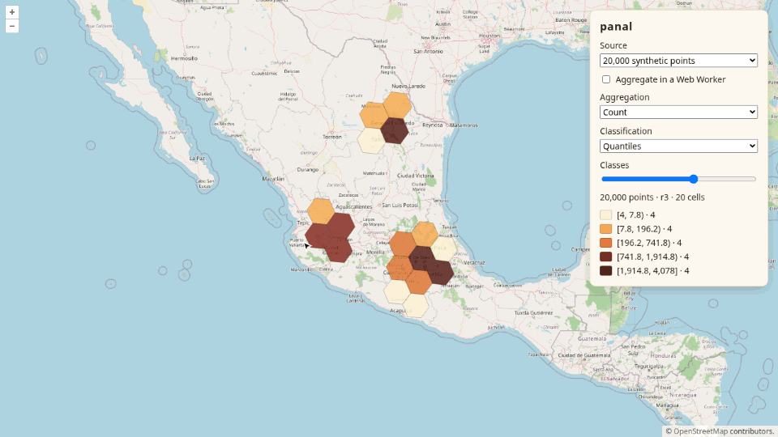

# <picture><source media="(prefers-color-scheme: dark)" srcset=".github/assets/icon-dark.svg"></picture> panal

[](https://www.npmjs.com/package/@npmegar/panal)
[](https://bundlejs.com/?q=@npmegar/panal)
[](LICENSE)

Headless H3 hexbin for OpenLayers: local, worker or server aggregation, zoom-driven resolution and classification.



**[Live demo](https://ghegar.github.io/panal/)**

panal owns the numbers — the [H3](https://h3geo.org) cell of each point, the value of each cell (count,
sum, mean, min, max or your own function), the resolution for the zoom with hysteresis, the class breaks
and the legend as data — and you own every pixel: it ships no colors and no CSS, only a style function
that receives `classIndex`, `value`, `count` and `selected`, or a deck.gl layer that takes your colors.
Points are grouped on the main thread, in a Web Worker or by your server.

## Install

```bash
npm install @npmegar/panal
```

| Entry | What it is | Needs |
|---|---|---|
| `@npmegar/panal/classify` | Breaks, class of a value, legend data | nothing |
| `@npmegar/panal` | Aggregation per cell, rollup, zoom → resolution picker, cell rings | `h3-js` (bundled dependency) |
| `@npmegar/panal/ol` | Hexbin layer, selection; GeoJSON, `VectorSource`, WFS and server-side cell inputs | `ol >= 10` |
| `@npmegar/panal/deckgl` | deck.gl layer from cells: columns, flat hexagons or dots; class counts for a histogram | `@deck.gl/core`, `@deck.gl/layers`, `@deck.gl/geo-layers` 9.4 |
| `@npmegar/panal/worker` | Client that runs the aggregation in a Web Worker | a module worker |
| `@npmegar/panal/worker/runtime` | `installAggregationWorker(self)` for your worker file | `h3-js` |
| `@npmegar/panal/react` | `useHexbinLayer` and `useHexbinSnapshot` | `react >= 19` |

## Quick start

```ts
import { createHexbinLayer, fromVectorSource } from '@npmegar/panal/ol';
import { Fill, Style } from 'ol/style.js';

const colors = ['#fde8d0', '#f9b97c', '#ef7d43', '#b8442a', '#5a1a14'];
const styles = colors.map(color => new Style({ fill: new Fill({ color }) }));

const hexbin = createHexbinLayer({
    map,
    source: fromVectorSource(points),
    classification: { method: 'jenks', classes: 5 },
    style: (_, { classIndex }) => styles[classIndex],
});

hexbin.subscribe(() => renderLegend(hexbin.getSnapshot().legend));
```

## Classification

```ts
import { classify, classOf, legend } from '@npmegar/panal/classify';

const result = classify(values, { method: 'jenks', classes: 5 });
classOf(42, result.breaks);
legend(result, values);
```

`classify` returns `{ method, breaks, requested, actual, stats }`; `legend` returns
`[{ classIndex, min, max, count, closed: 'left' | 'both' }]`.

| Method | Breaks |
|---|---|
| `quantile` | Linear interpolation at `(n - 1) · i / k` |
| `jenks` | Exact Fisher-Jenks; each break is the first value of the upper class. Above 4 000 values it runs on a deterministic sample (sorted values at a fixed step, extremes included) |
| `equalInterval` | `classes` intervals of the same width between minimum and maximum |
| `stdDev` | Classes of `interval` standard deviations (`1` or `0.5`), the middle one centered on the mean, up to three deviations; `classes` is ignored |
| `manual` | Your breaks as they are, strictly increasing |

- `breaks` holds `actual + 1` numbers, minimum and maximum included.
- Every class is `[min, max)` except the last one, `[min, max]`: the rule SLD range filters use (`>=`
  lower, `<` upper, `<=` on the last class), so a map and an SLD built from the same breaks agree.
- When the data cannot fill the requested classes (repeated values, fewer values than classes),
  repeated breaks collapse and `actual < requested` tells you so. A last class made only of the
  maximum is kept as `[max, max]`.
- Non-finite values are ignored and get class `-1`.

`test/fixtures/classify/*.json` holds reference vectors for other implementations: input values
(non-finite ones as `"NaN"` and `"Infinity"`), options and expected breaks with a relative tolerance.

## Aggregation and resolution

```ts
import { aggregate, createResolutionPicker } from '@npmegar/panal';

const cells = aggregate([{ coordinates: [[-103.35, 20.67]], member: 'a', value: 12 }], { resolution: 7, reducer: 'mean' });
const picker = createResolutionPicker({ hysteresis: 0.3 });
picker.pick(map.getView().getZoom() ?? 0);
```

`aggregate` returns a `Map<h3Index, { h3Index, count, valueCount, sum, min, max, value, members }>`. A
member with several coordinates (a multipoint) counts once in every cell it touches.

| Piece | Behavior |
|---|---|
| Default table | About 40 cells across a 1 000 px viewport at the equator. Pass your own `table` (`[{ maxZoom, resolution }]`) to change it |
| Hysteresis | With `hysteresis: h` the resolution only changes once the zoom goes `h` levels past a threshold |
| Latitude | `pick(zoom, latitude)` adds `log2(1 / cos φ)` to the zoom, because Web Mercator stretches cells away from the equator; the layer passes the latitude of the view center. Off with `latitudeCorrection: false` |
| `rollup(cells, { resolution, reducer })` | Parent cells from finer ones without the points: counts, sums and value counts add up, min and max combine, the mean is `sum / valueCount`. Custom reducers cannot be rolled up |
| `resolution: { hierarchical: true }` | The layer aggregates the points once, at the finest resolution of the table (or `hierarchical: { base }`), and derives every coarser one with `rollup`. Zooming out no longer walks the points, and a zoom level always shows the same cells however it was reached. Custom reducers bypass it |
| `resolution: { fixed: 7 }` | Pins the resolution |

## OpenLayers

```ts
import { bindCellClick, createHexbinLayer, fromVectorSource } from '@npmegar/panal/ol';

const hexbin = createHexbinLayer({
    map,
    source: fromVectorSource(points),
    value: 'population',
    reducer: 'sum',
    style: (feature, { classIndex, selected }) => (selected ? highlight : myStyles[classIndex]),
});

hexbin.setClassification({ method: 'jenks' });
hexbin.setReducer('mean');
const unbind = bindCellClick(hexbin, map, { toggle: true });
hexbin.destroy();
```

The layer adds itself to `map`, defaults to `reducer: 'count'`, quantiles in 5 classes and hysteresis
0.3, and reaggregates when the resolution changes on `moveend` and, at most once per frame, when the
vector source changes. Each cell feature carries `h3Index`, `value`, `count` and `classIndex`, and its id
is the H3 index. Members are not stored on the feature, so cell features stay plain data that can be
serialized (to GeoJSON, to a MapLibre source); read them with `getCell(h3Index)`, `cellAt(coordinate)`
or from `getSnapshot().selection`. The selection, `{ h3Index, cell, members, status, error } | null`, is set with `select(h3Index)` or a
click. The clicked cell is found by its H3 index, not by hit-testing pixels, so it works on transparent
fills and in tests. It survives reaggregation while its cell still exists. In server mode, members come
from the optional `loadMembers` of the cell provider and the selection reports `loading` meanwhile.

### Sources

| Source | Where the points live |
|---|---|
| `fromGeoJSON(data)` | A GeoJSON object or string, read in the projection of the view |
| `fromVectorSource(source)` | An OpenLayers `VectorSource`; changes are picked up |
| `fromWfs(options)` | Pages of a WFS, on the main thread |
| `createWorkerWfsSource(thread, options)` | Pages of a WFS, kept inside the worker |
| `fromCellProvider(options)` | No points: cells already counted by your server |

`fromWfs({ url, typeName, cql, propertyNames, sortBy, version, pageSize, maxFeatures })` defaults to
WFS `'2.0.0'` (or `'1.1.0'`), pages of 5000 and 100 000 features at most; `cql` is a filter such as
`'year = 2025'`. Nothing is requested until the layer reads the source. Pages are fetched as GeoJSON
with `startIndex` and `count` (`maxFeatures` on WFS 1.1.0), in the projection of the view, so axis order
never gets in the way. `getState()` returns `{ status, loaded, truncated, error }`; `truncated` turns
true when the layer has more features than `maxFeatures`.

### Server-side cells

```ts
import { fromCellProvider } from '@npmegar/panal/ol';

const source = fromCellProvider({
    resolutions: [3, 4, 6, 7],
    extentDependent: false,
    load: ({ resolution, extent, signal }) => fetch(`/cells?r=${resolution}&bbox=${extent.join(',')}`, { signal }).then(r => r.json()),
});
```

`load` returns `[{ h3Index, value, count? }]`; panal only classifies and draws, and the hexagon comes
from the index, so the server sends no geometry. With `resolutions`, panal asks for the finest available
resolution that does not exceed the one the zoom wants (or the coarsest when none fits). Add
`rollup: 'sum' | 'min' | 'max' | 'mean'` and, when the zoom wants a coarser resolution than the server
has, panal rolls the coarsest one up; `mean` is weighted by `count`. A superseded request is aborted and
its answer ignored. `getSnapshot().status` is `loading` while waiting and `error` (with `error`) if the
provider throws.

### Events and shared map state

`createHexbinLayer({ ..., onEvent })` reports `{ type: 'select', h3Index }`, `{ type: 'resolution',
resolution }`, `{ type: 'classification', classification }` (only when the breaks change) and
`{ type: 'status', status, error }`.

panal can plug into a host that shares the map between tools without depending on it; anything with
the same shape works:

```ts
bboxCql('geom', extent, undefined, { composer });
bindCellClick(hexbin, map, { arbiter, tool: 'hexbin' });
legendEntry('crimes', 'Crimes', snapshot.classification, colors, snapshot.legend.map(c => c.count));
```

| Option | Shape it expects | What happens |
|---|---|---|
| `composer` (+ `fragment`, default `'bbox'`) | `{ set(name, fragment \| null) }` | The `BBOX(...)` part is written as a named CQL fragment, so it does not overwrite the filters of other tools |
| `arbiter` (+ `tool`, default `'hexbin'`) | `{ claim(tool, { click, escape }) => release }` | The cell click goes through the arbiter instead of `singleclick`; `click` receives `{ coordinate: [lon, lat] }`, `escape` clears the selection, unbinding releases it. Use `tool: 'identify'` to select only when no other tool holds the click |
| `legendEntry(layerId, title, classification, colors, counts?, { format? })` | — | `{ kind: 'classes', layerId, title, classes: [{ label, color, min, max, count? }] }`, a plain legend entry |

## deck.gl

```ts
import { aggregate } from '@npmegar/panal';
import { classify } from '@npmegar/panal/classify';
import { classCounts, createHexbinDeckLayer } from '@npmegar/panal/deckgl';
import { MapLibreOverlay } from '@deck.gl/maplibre';

const cells = aggregate(points, { resolution: 6 });
const classification = classify([...cells.values()].map(cell => cell.value), { method: 'jenks' });
const overlay = new MapLibreOverlay({ interleaved: true, layers: [] });
map.addControl(overlay);
overlay.setProps({ layers: [createHexbinDeckLayer({ cells, classification, colors, onSelect: cell => show(cell) })] });
renderHistogram(classCounts(cells, classification));
```

`createHexbinDeckLayer` is a plain function: call it on every render with the same `id` and let deck.gl
diff the props. It works with `MapLibreOverlay`, `MapboxOverlay` or a bare `Deck`; whether it renders
on WebGPU or WebGL2 is up to the device you give deck.gl.

| Option | Default | |
|---|---|---|
| `cells` | — | The `Map` from `aggregate` or `rollup`, or `[{ h3Index, value, count? }]` from a server |
| `classification` | — | `{ breaks }` from `classify`; the class uses the same `[min, max)` rule |
| `colors` | — | One RGB(A) array per class, a longer ramp spread over the classes, or `(classIndex, classes) => color` |
| `style` | `'columns'` | `'columns'`: extruded `H3HexagonLayer`; `'flat'`: the same, not extruded; `'dots'`: `ScatterplotLayer` at the cell center, id suffixed `:dots` |
| `metric` | `'value'` | What drives height and radius: `'value'` or `'count'` |
| `maxElevation`, `maxRadius` | 10 and 0.85 edge lengths | Meters for the largest cell; the rest scale linearly (height) or by area (radius); negatives stay at 0 |
| `noClassColor` | transparent | Cells outside the breaks |
| `selected`, `selectedColor` | — | Paint one cell |
| `onSelect`, `pickable` | —, `true` | `onSelect({ h3Index, value, count, classIndex }, info)` on click; clear it from the overlay `onClick` |
| `coverage`, `id`, `props` | 0.9 in columns, `'panal-hexbin'` (`:dots` or `:relief` appended, see below) | `props` is spread last (`opacity`, `beforeId`, `transitions`…) |
| `getBaseElevation`, `baseTrigger` | — | `({ h3Index, position }) => meters`: each column (or dot) starts at that height instead of 0; change `baseTrigger` when the ground changes |

Normalized cells are cached by the identity of `cells`, so the same `Map` keeps the same `data` and deck.gl
does not rebuild geometry; breaks, colors, metric, scale and selection travel in `updateTriggers` as
strings. Pass a new `Map` when the cells change. `classCounts(cells, classification)` returns the
number of cells per class.

### Terrain

Over MapLibre terrain, columns that start at 0 sink under the relief. `getBaseElevation` lifts every
cell to its own ground, for example sampled from the map's DEM:

```ts
createHexbinDeckLayer({
    cells, classification, colors,
    getBaseElevation: ({ position }) => map.queryTerrainElevation(position) ?? 0,
    baseTrigger: terrainVersion,
});
```

`queryTerrainElevation` already includes the terrain exaggeration and only knows the DEM tiles loaded
for the current view, so recompute on `idle` or `terrain` and bump `baseTrigger`. The base is the
absolute height of the ground, in the same meters as the DEM: do not add a `modelMatrix` on top, and
`elevationScale` only scales the column height, never the base. With a base the columns are drawn by a
`ColumnLayer` with the H3 hexagon outline of the first cell, as `H3HexagonLayer` does at resolutions
above 5; very large views or low resolutions distort a little.

That layer is named `<id>:relief`, so turning the base on or off never hands the state of an
`H3HexagonLayer` to a `ColumnLayer` with the same id (deck.gl matches layers by id, and the new one
would not be drawn). `hexbinLayerId(info.layer.id)` drops the `:relief` or `:dots` suffix of a picked
layer.

Columns keep their size in meters: close to the ground, a coarse cell is wider than the camera is
high, so lower `maxElevation` or pick a finer resolution as the map zooms in.

### Overlay

```ts
import { MapLibreOverlay } from '@deck.gl/maplibre';
import { createHexbinOverlay } from '@npmegar/panal/deckgl';

const hexbin = createHexbinOverlay(MapLibreOverlay, map, { interleaved: true });
hexbin.setLayers([createHexbinDeckLayer({ ...options, props: { beforeId: 'labels' } })]);
```

`createHexbinOverlay(Overlay, map, options)` creates the overlay, adds it as a control and returns
`{ overlay, interleaved, setLayers, redraw, canvases, destroy }`. panal does not import
`@deck.gl/maplibre`; you pass the class.

- **Order.** deck.gl inserts interleaved layers only when `map.isStyleLoaded()` is true, which waits for
  every tile source to finish. `setLayers` places them (and moves them to their `beforeId`) as soon as
  the style itself is parsed, and again on every `styledata`, so a `beforeId` computed from your layer
  order applies while WMS tiles are still loading.
- **Capture.** Overlaid, deck.gl draws on its own canvas, which is cleared after each frame.
  `canvases()` forces a synchronous redraw and returns that canvas, ready to copy in the same task (for
  example as cartela's `overlays`); `preserveDrawingBuffer: true` creates the overlay with a preserved
  buffer instead, at some cost. Interleaved, the layers are part of the map canvas and `canvases()` is
  empty. `overlayProps(options)` gives the constructor props alone.

## Web Worker

```ts
import { installAggregationWorker } from '@npmegar/panal/worker/runtime';
installAggregationWorker(self);
```

```ts
import { createAggregationWorker } from '@npmegar/panal/worker';

const thread = new Worker(new URL('./hexbin.worker.ts', import.meta.url), { type: 'module' });
const worker = createAggregationWorker(thread);
createHexbinLayer({ map, source, style, aggregator: worker.aggregate });
```

The first block is your `hexbin.worker.ts`, compiled with the `WebWorker` lib. Coordinates travel as
transferable typed arrays and the worker returns per-cell statistics and member ids. Local and worker
aggregation share the same code, so they return the same cells; custom reducers work too, because the
final reduction runs on the main thread. `hexbin.setAggregator(undefined)` goes back to local aggregation.

### WFS inside the worker

For large layers the cost is downloading and parsing, not grouping.
`createWorkerWfsSource(thread, { url, typeName, value, reducer })` pages the WFS inside the worker (in
`EPSG:3857`, converted with an inverse Mercator), aggregates there, and only cells cross to the main
thread; pass it as the layer `source` and change the reducer with `source.setReducer('mean')`. Clicked
cells fetch their members from the worker and rebuild them as features.

The aggregator and any number of worker sources can share one `Worker`; `getState()` works as in
`fromWfs`. Add `bbox: { geometryName: 'geom', margin: 0.5 }` to download only the view, grown by
`margin` on each side so the cells along the visible edge are complete. The box goes into the CQL as
`BBOX(geom, …, 'EPSG:3857')`, joined with your own `cql`. While the view stays inside what was
downloaded nothing is fetched again; leaving it fetches the new area and aborts the previous one.
`lonLatToMercatorExtent`, `expandExtent`, `containsExtent` and `bboxCql` are exported to count the same
view before downloading it.

## React

```tsx
import { useHexbinLayer, useHexbinSnapshot } from '@npmegar/panal/react';

const hexbin = useHexbinLayer(map && { map, source, style, classification, reducer, value, selectOnClick: true });
const snapshot = useHexbinSnapshot(hexbin);
```

The layer is created in an effect and destroyed on unmount; a new `map` or `source` recreates it.
Style, classification (compared by value), reducer, value field, aggregator and click binding are
applied in place. Custom reducers and style functions are compared by identity: memoize them.

## Known limitations

- Custom reducers cannot be rolled up, bypass the hierarchical mode and do not run in
  `createWorkerWfsSource`, which takes only built-in reducers.
- H3 children overhang their parent, so a rolled-up cell is the H3 hierarchy's answer, not the same as
  aggregating the points straight at the coarse resolution: in a test over central Mexico about 6 % of
  points land in a different coarse cell. Totals are preserved.
- In MapLibre, deck.gl interleaved mode shares MapLibre's WebGL2 context; WebGPU only runs overlaid,
  and deck.gl 9.4 still calls it experimental. Columns follow MapLibre terrain only through
  `getBaseElevation`.
- `redraw` and `canvases()` call the overlay's internal `Deck` (`_deck.redraw`), which deck.gl does not
  document; if it goes away, create the overlay with `preserveDrawingBuffer: true`.
- WFS needs GeoJSON output (`application/json`) and paging with `startIndex`. `cql` and `bbox` travel
  as `CQL_FILTER`, a GeoServer vendor parameter.

## Development

```bash
npm test
npm run lint
npm run typecheck
npm run build
npm run demo
npm run e2e
```

`npm run e2e` runs Playwright; set `CDP_URL` to drive an already running Chrome. The demo shows 20 000
synthetic points over Mexico, the `sf:bugsites` WFS of a public GeoServer on the main thread or inside
the worker, and a simulated server with resolutions 3 to 7; it switches reducer (including a custom
range), classification method and number of classes, and selects cells on click. Its second page,
`deck.html`, draws the synthetic points with deck.gl on MapLibre as columns, flat hexagons or dots, with
a histogram legend.

## Contributing

Issues are welcome. Open one before sending a pull request.

## License

AGPL-3.0-only © GHEgar
